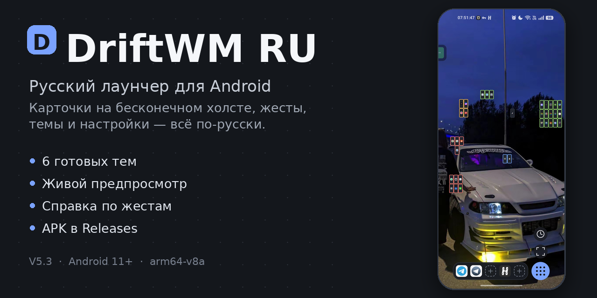
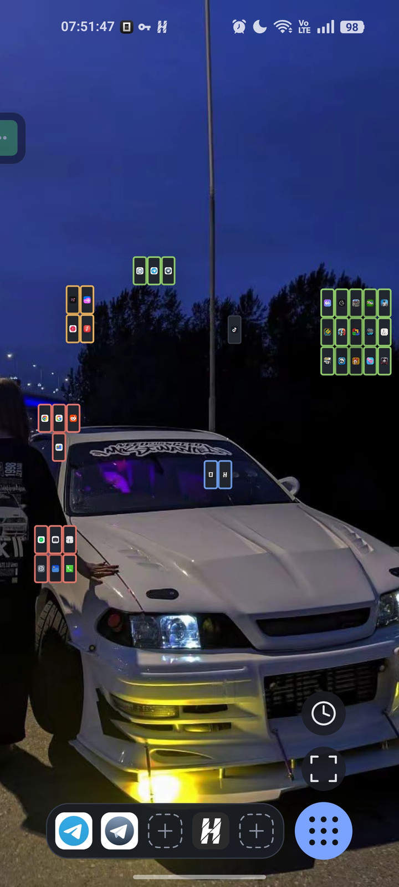
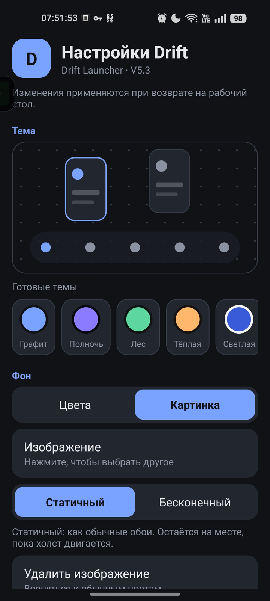
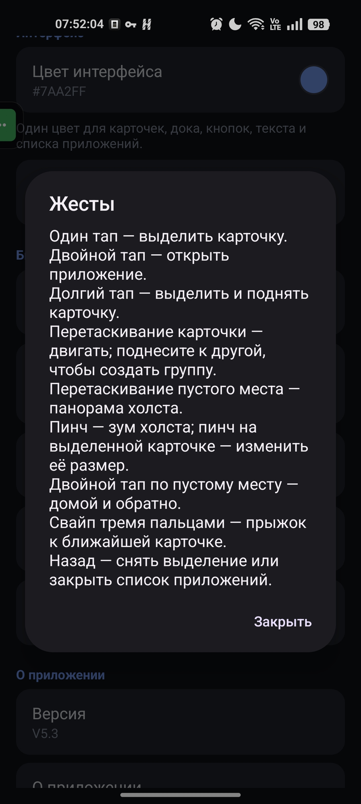
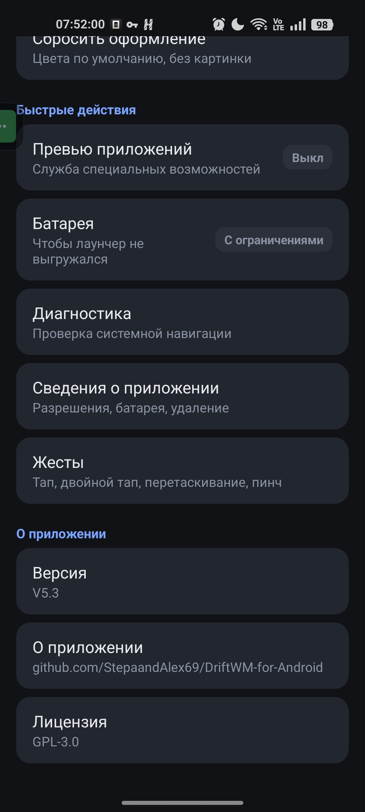
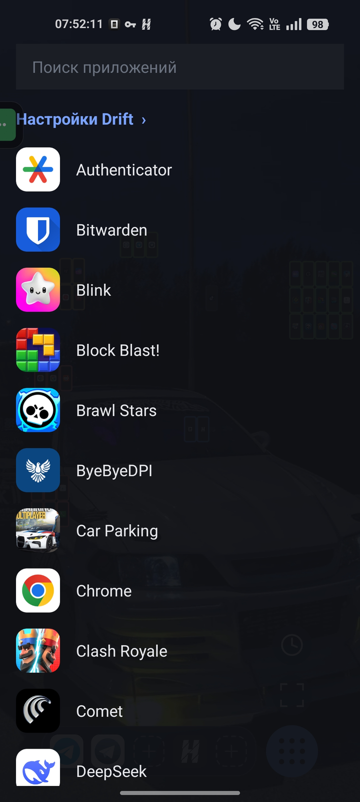

# Drift Launcher — русская сборка



[](https://github.com/Prostochel105/driftwm-ru/actions/workflows/build-apk.yml)
[](https://github.com/Prostochel105/driftwm-ru/releases/latest)
[](https://github.com/Prostochel105/driftwm-ru/releases)

**[Скачать последний APK](https://github.com/Prostochel105/driftwm-ru/releases/latest)**

Форк [DriftWM-for-Android](https://github.com/StepaandAlex69/DriftWM-for-Android) с русским интерфейсом.
Основа — upstream V5. Лицензия — GPL-3.0, как у оригинала.

> English version: [README.md](README.md)

## Что переведено

- Экран «Настройки Drift»: фон, цвета, картинка, интерфейс, сброс.
- Панель выделенной карточки: Центр, Группа, В док, Удалить, Превью.
- Список приложений: поиск, строка настроек, выбор приложения для слота дока.
- Меню дока (заменить/убрать), экран краша, диагностика.
- Название и описание службы «Drift: превью приложений» в специальных возможностях.

Язык выбирается по системному: если система русская — интерфейс русский, иначе английский.
Тосты, которые генерирует Rust-ядро, переведены частично (самые частые); остальные остаются английскими.

## Скриншоты

realme 11 4G, V5.3.

| Рабочий стол | Настройки | Жесты |
|:---:|:---:|:---:|
|  |  |  |
| **Быстрые действия** | **Список приложений** | |
|  |  | |

## Как это устроено

- **Java-оболочка** — домашняя активити, отрисовка холста, список приложений, настройки и системная интеграция.
- **Rust-ядро через JNI** — модель рабочего стола, жесты, привязки, сохранение и display list.
- **LauncherApps API** — список запускаемых приложений, иконки и события пакетов без `QUERY_ALL_PACKAGES`.
- **Служба специальных возможностей** — необязательные превью приложений, которые хранятся только на телефоне.

## Экран настроек

Настройки открываются из списка приложений → **«Настройки Drift ›»**.

| Раздел | Что можно сделать |
|---|---|
| **Тема** | Живой предпросмотр рабочего стола и 6 готовых тем: Графит, Полночь, Лес, Тёплая, Светлая, Розовая |
| **Фон** | Цвета или своя картинка; статичные обои или бесконечный тайл, привязанный к холсту |
| **Интерфейс** | Один акцентный цвет, из которого выводятся карточки, док, кнопки, текст и список приложений; число слотов в доке (3–8) и справка по папкам |
| **Быстрые действия** | Превью (статус Вкл/Выкл), батарея (статус «Без ограничений»), диагностика, сведения о приложении, справка по жестам |
| **О приложении** | Версия, ссылка на исходники, лицензия |

Статусы обновляются при возврате из системных настроек, так что сразу видно, включена ли служба
превью и снято ли ограничение батареи.

## Док и папки

Док находится внизу экрана. В нём от 3 до 8 слотов — число меняется в разделе
**Интерфейс → «Приложения в доке»**. Значение хранится вместе с раскладкой.

- **Пустой слот** — тап, чтобы выбрать приложение; долгий тап открывает меню.
- **Занятый слот** — тап открывает приложение, долгий тап открывает меню.
- **Переставить слоты** — долгий тап по слоту и перетащите его в сторону.

### Папки

- **Создать** — долгий тап по слоту → **«Создать папку»**. Занятый слот оставит приложение внутри; пустой сразу откроет пустую папку.
- **Добавить приложение** — откройте папку и нажмите свободный слот **«+»**, затем выберите приложение; рядом появится ещё один свободный слот.
- **Открыть приложение из папки** — тап по папке, затем тап по приложению.
- **Переставить внутри папки** — долгий тап по приложению и перетащите его на другое место.
- **Убрать приложение из папки** — перетащите приложение за пределы папки (на затемнённый фон); папка останется со свободным слотом.
- **Переименовать** — откройте папку и тапните по названию; либо долгий тап по папке в доке → **«Переименовать папку»**.
- **Убрать папку** — долгий тап по папке в доке → **«Убрать из дока»**.

Эту же справку можно открыть в приложении: **Настройки Drift → Интерфейс → «Папки в доке»**.

## Установка (первый раз)

**Требования:** Android 11+ (API 30), arm64-v8a.

Оригинальный Drift подписан другим ключом, поэтому поверх него этот APK **не встанет**.

1. Настройки → Приложения → **Приложения по умолчанию** → «Главный экран» → верните стоковый лаунчер.
2. Удалите оригинальный Drift. Вместе с ним удалится `workspace.json` — раскладка карточек.
3. Установите APK из этого репозитория (разрешите установку из неизвестных источников).
4. Назначьте Drift домашним приложением заново.

Дальше обновления ставятся **поверх** без удаления: все сборки подписываются одним ключом
(`android/app/drift-ru-debug.keystore`, пока в CI не настроен отдельный release-ключ), а
`versionCode` начинается с 101 — выше официальных 7–9, поэтому форк ставится поверх. Раскладка и
настройки сохраняются. Облачный бэкап Android для приложения отключён (`allowBackup=false`):
раскладка хранится только на устройстве.

## Как обновлять

### Вариант 1: GitHub Actions (рекомендую)

1. Сделайте **fork** этого репозитория (или сразу форкните upstream и загрузите сюда эти файлы).
2. Вкладка **Actions** → workflow **build-apk** → **Run workflow**.
3. Дождитесь зелёной галочки, скачайте артефакт **drift-ru-apk**, внутри — `app-release.apk`.
4. Установите APK поверх старого.

Когда выйдет новая версия оригинала:

- На странице своего форка нажмите **Sync fork → Update branch**.
- Если конфликтов нет, GitHub сам обновит код и запустит сборку.
- Скачайте новый APK и поставьте поверх — данные сохранятся.

Если GitHub пишет **conflicts**, обновите вручную (вариант 2) или попросите ИИ разрешить конфликт.
Чаще всего конфликтуют только файлы, куда встроен перевод:
`L.java`, `SettingsActivity`, `DrawerView`, `CanvasView`, `LauncherActivity`, `ColorPickerDialog`, `DiagnosticsActivity`.

### Вариант 2: локально

```bash
git remote add upstream https://github.com/StepaandAlex69/DriftWM-for-Android.git
git fetch upstream
git merge upstream/main
# если есть конфликты — исправьте, затем:
git add -A && git commit
git push
```

Либо просто запустите `./sync-upstream.sh` — он сделает fetch и merge и покажет конфликтующие файлы.

После push GitHub Actions соберёт APK автоматически.

### Вариант 3: попросить ИИ пересобрать

Перевод устроен минимально: новый файл `L.java` + вызовы `L.t(...)` в нескольких активити.
При обновлении upstream достаточно перенести эти правки на новую версию — это занимает пару минут.

## Ключ подписи

По умолчанию APK подписывается **debug-ключом** `android/app/drift-ru-debug.keystore`:

- alias: `driftru`, пароль хранилища и ключа: `driftru`.
- Он не секретный и не годится для Google Play — это личная сборка.
- **Не удаляйте и не пересоздавайте его**: иначе обновление поверх старой версии перестанет ставиться,
  и придётся удалять приложение вместе с раскладкой.
- Ключ публичный, поэтому теоретически кто угодно может подписать APK с тем же именем пакета.
  Ставьте обновления только из **Releases** этого репозитория.

Для нормальной подписи задайте в GitHub **Settings → Secrets and variables → Actions** четыре секрета:
`DRIFT_KEYSTORE_BASE64` (keystore в base64), `DRIFT_KEY_ALIAS`, `DRIFT_KEYSTORE_PASSWORD`,
`DRIFT_KEY_PASSWORD`. Workflow сам подставит их в сборку. Первый переход с debug-ключа на новый
требует одной переустановки с потерей раскладки — дальше обновления снова ставятся поверх.

## Сборка

### GitHub Actions

Workflow `.github/workflows/build-apk.yml` сначала гоняет `cargo test` и `cargo clippy`, затем
собирает **release**-APK на x86_64-раннере GitHub: JDK 17 + Android SDK 36 + NDK + Rust + cargo-ndk.
APK лежит в артефакте `drift-ru-apk`. Пуш тега `v*` дополнительно публикует GitHub Release с APK.

### Локально (Linux x86_64)

Нужны JDK 17, Rust, cargo-ndk, Android SDK 36 и NDK r28+:

```bash
rustup target add aarch64-linux-android
cargo install cargo-ndk --locked
export ANDROID_HOME=$HOME/Android/Sdk
export ANDROID_NDK_HOME=$ANDROID_HOME/ndk/28.2.13676358
cd android
./gradlew assembleRelease
```

APK: `android/app/build/outputs/apk/release/app-release.apk`.

Если Rust-ядро уже собрано вручную и лежит в `android/app/src/main/jniLibs/arm64-v8a/`,
сборку Java можно запустить без cargo-ndk:

```bash
./gradlew assembleRelease -PskipRust
```

### Сборка на arm64 (как на телефоне)

Официальные build-tools и NDK есть только под x86_64, поэтому на arm64 нужны
собранные вручную build-tools (aapt2, zipalign, aidl) и clang/lld из системы.
Это рабочий, но нестандартный путь; для регулярных обновлений проще GitHub Actions.

## Изменения в коде

- `L.java` — словарь английских строк на русские + перевод тостов ядра.
- `SettingsActivity`, `DrawerView`, `CanvasView`, `LauncherActivity`, `ColorPickerDialog`, `DiagnosticsActivity` — использование `L.t(...)`.
- `res/values-ru/strings.xml` — локализация службы превью.
- `android/app/build.gradle` — фиксированный ключ подписи и флаг `-PskipRust`.
- `.github/workflows/build-apk.yml` — сборка APK в CI.

## Журнал изменений

См. [CHANGELOG.md](CHANGELOG.md).

## Ограничения

- Системные Recents (свайп вверх) Drift не заменяет — это часть прошивки.
- Часть тостов Rust-ядра остаётся на английском.
- Подпись debug: Play Protect может предупредить о «неизвестном приложении». Это нормально.
- APK собирается только под arm64-v8a.
