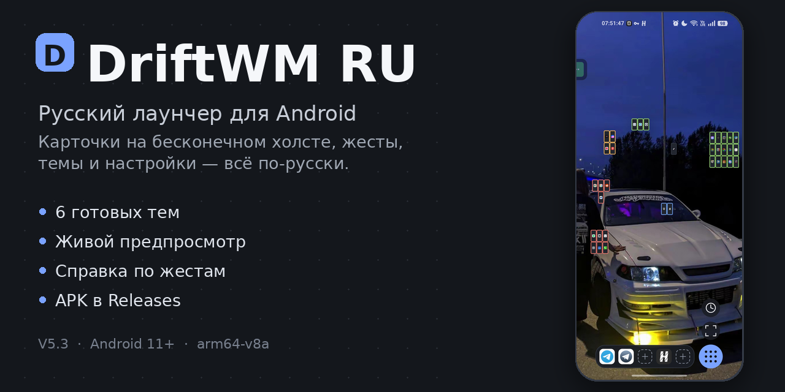
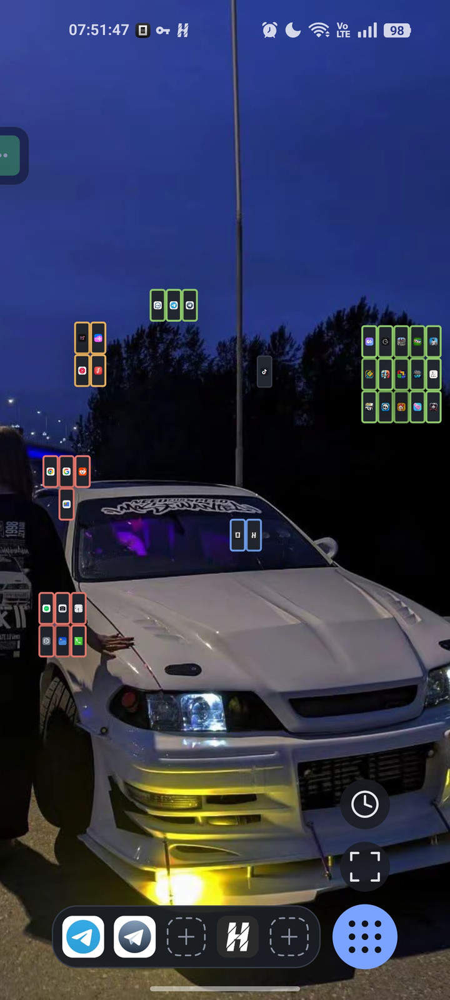
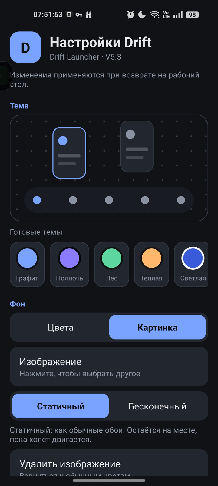
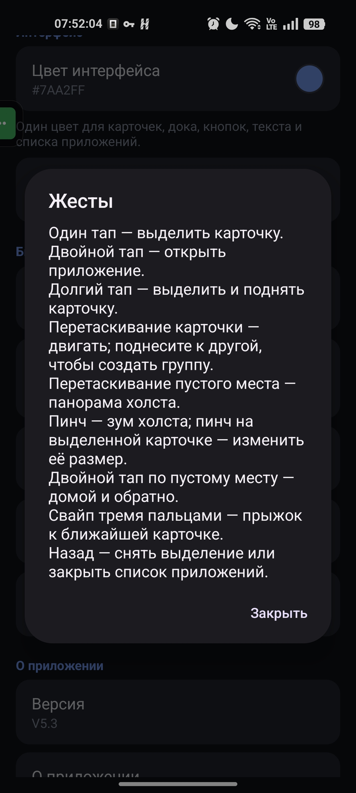
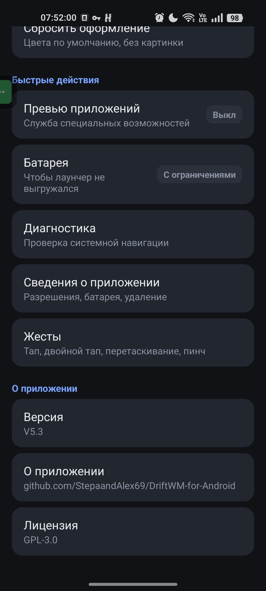
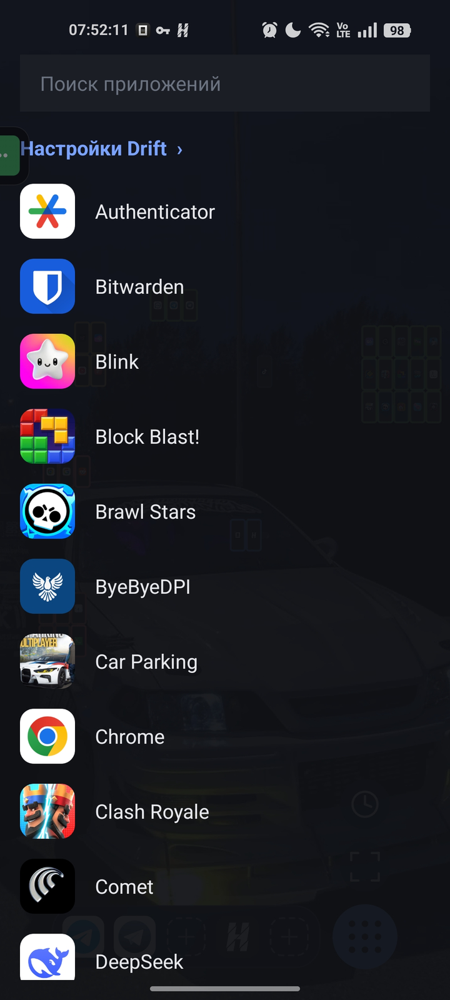

# DriftWM RU



[](https://github.com/Prostochel105/driftwm-ru/actions/workflows/build-apk.yml)
[](https://github.com/Prostochel105/driftwm-ru/releases/latest)
[](https://github.com/Prostochel105/driftwm-ru/releases)

**[Download the latest APK](https://github.com/Prostochel105/driftwm-ru/releases/latest)**

Russian localization and a redesigned settings screen for
[DriftWM for Android](https://github.com/StepaandAlex69/DriftWM-for-Android).

Based on upstream **V5**. Licensed under **GPL-3.0**, same as the original.

> Русская версия описания: [README-RU.md](README-RU.md)

## What this fork adds

- **Full Russian UI.** The language follows the system locale: Russian on a Russian phone,
  English everywhere else.
- **A real settings screen.** Live home-screen preview, six ready-made themes, colour pickers,
  background picture with static/infinite modes, and quick system shortcuts.
- **Status at a glance.** The settings screen shows whether the preview accessibility service is
  enabled and whether the launcher is exempt from battery optimisation, and opens the right system
  page in one tap.
- **Built-in gesture reference.** A Russian help sheet explains tap, double tap, drag, pinch and
  three-finger navigation without leaving the settings screen.
- **Updates that keep your layout.** Every build is signed with the same key
  (`android/app/drift-ru-debug.keystore`, or a real release key when CI secrets are configured), and
  `versionCode` starts at 101 — above the official 7–9 — so a fork build installs **over** the previous
  one. No uninstall, no lost cards.
- **CI builds and tests.** GitHub Actions runs `cargo test` + `cargo clippy`, builds the release APK on
  every push, and publishes a GitHub Release when a `v*` tag is pushed.

## Screenshots

Realme 11 4G, V5.3.

| Home | Settings | Gestures |
|:---:|:---:|:---:|
|  |  |  |
| **Quick actions** | **App list** | |
|  |  | |

## How it works

- **Java shell** — home activity, canvas rendering, drawer, settings and system integration.
- **Rust core over JNI** — workspace model, gesture recognition, snapping, persistence and the display list.
- **LauncherApps API** — launchable apps, icons and package events without `QUERY_ALL_PACKAGES`.
- **Accessibility service** — optional app previews, stored only on the device.

## Settings screen

| Section | What you can do |
|---|---|
| **Theme** | Preview the home screen and apply one of six themes: Graphite, Midnight, Forest, Warm, Light, Rose |
| **Background** | Colours or your own picture; static wallpaper or an infinite tile attached to the canvas |
| **Interface** | One accent colour that derives cards, dock, buttons, text and the app list; dock slot count (3–8) and a folders help sheet |
| **Quick actions** | Accessibility previews (with On/Off status), battery optimisation (with status), diagnostics, app info, gesture reference |
| **About** | Version, source link, license |

## Dock and folders

The dock sits at the bottom of the screen. It has 3 to 8 slots; change the number under
**Interface → "Dock apps"**. The value is stored with the layout.

- **Empty slot** — tap to choose an app; long-press opens its menu.
- **Filled slot** — tap opens the app, long-press opens its menu.
- **Reorder** — long-press a slot and drag it sideways.

### Folders

- **Create** — long-press a slot → **"Create folder"**. An app slot keeps its app inside; an empty slot opens an empty folder right away.
- **Add an app** — open the folder and tap the free **"+"** slot, then pick an app; another free slot appears beside it.
- **Open an app in a folder** — tap the folder, then tap the app.
- **Reorder inside a folder** — long-press an app and drag it onto another tile.
- **Take an app out** — drag the app out of the folder (onto the dimmed area); the folder stays with a free slot.
- **Rename** — open the folder and tap its title; or long-press the folder in the dock → **"Rename folder"**.
- **Remove the folder** — long-press the folder in the dock → **"Remove from dock"**.

The same help is available in the app: **Drift settings → Interface → "Folders in the dock"**.

## Install

**Requirements:** Android 11+ (API 30), arm64-v8a.

The upstream Drift is signed with a different key, so the first install requires removing it.

1. Set your stock launcher as the home app: **Settings → Apps → Default apps → Home app**.
2. Uninstall the original Drift. This deletes `workspace.json` (the card layout).
3. Install the [latest APK](https://github.com/Prostochel105/driftwm-ru/releases/latest) (allow installation from unknown sources).
4. Set Drift as the home app again.
5. Open **Drift settings → Quick actions** and enable previews and unrestricted battery.

After that, updates install over the old version and keep all data.

## Build

### GitHub Actions

Push to `main`/`master` or run the **build-apk** workflow manually.
The APK appears in the `drift-ru-apk` artifact.

The workflow installs JDK 17, Android SDK 36, NDK r28 and Rust with the
`aarch64-linux-android` target, then runs `./gradlew assembleRelease`.

### Locally (Linux x86_64)

```bash
rustup target add aarch64-linux-android
cargo install cargo-ndk --locked
export ANDROID_HOME=$HOME/Android/Sdk
export ANDROID_NDK_HOME=$ANDROID_HOME/ndk/28.2.13676358
cd android
./gradlew assembleRelease
```

APK: `android/app/build/outputs/apk/release/app-release.apk`.

If the Rust core is already built in `android/app/src/main/jniLibs/arm64-v8a/`, skip cargo-ndk:

```bash
./gradlew assembleRelease -PskipRust
```

## Updating from upstream

```bash
./sync-upstream.sh   # fetch + merge upstream/main, lists conflicts if any
git push
```

Or on GitHub: **Sync fork → Update branch**. Actions rebuilds the APK automatically.

Conflicts are usually limited to the files where the translation is wired in:
`L.java`, `SettingsActivity`, `DrawerView`, `CanvasView`, `LauncherActivity`,
`ColorPickerDialog`, `DiagnosticsActivity`.

## Project layout

```
android/app/src/main/java/dev/drift/launcher/
  L.java                 Russian string map + toast translation
  SettingsActivity.java  Redesigned settings UI (themes, preview, shortcuts)
  Appearance.java        Background, colours, palette derivation
  ...
android/app/src/main/res/values-ru/strings.xml   Localized accessibility strings
.github/workflows/build-apk.yml                  CI APK build
README-RU.md                                     Russian documentation
sync-upstream.sh                                 Upstream merge helper
```

## Signing

By default the APK is signed with the **debug** key `android/app/drift-ru-debug.keystore` (alias
`driftru`, store and key password `driftru`). It is not a secret and not suitable for Google Play.
Keep it: replacing it makes future APKs impossible to install over the current one.

For a real signature, add four repository secrets: `DRIFT_KEYSTORE_BASE64`, `DRIFT_KEY_ALIAS`,
`DRIFT_KEYSTORE_PASSWORD`, `DRIFT_KEY_PASSWORD`. The workflow then signs with that key. Switching from
the debug key to a new one requires one uninstall/reinstall, because Android refuses an update signed
with a different key.

> **Security note.** Because the fallback key is public, anyone can sign an APK for this package name.
> Install updates only from this repository's **Releases** page, and treat APKs from other sources
> as untrusted.

## Changelog

See [CHANGELOG.md](CHANGELOG.md).

## Limitations

- The Rust core still emits some English toasts; the most common ones are translated in `L.toast`.
- System Recents (the gesture/overview screen) belong to the firmware and are not replaced by Drift.
- APKs are built for `arm64-v8a` only.

## Credits

- [DriftWM](https://github.com/malbiruk/driftwm) — the original project.
- [DriftWM for Android](https://github.com/StepaandAlex69/DriftWM-for-Android) — the Android port this fork is based on.
- Russian localization and settings redesign: this fork.
